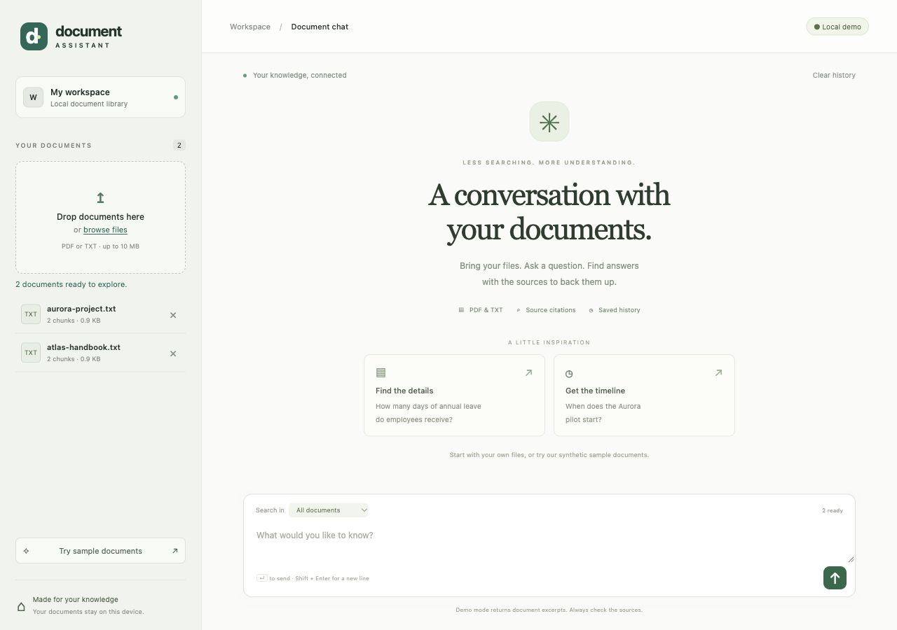
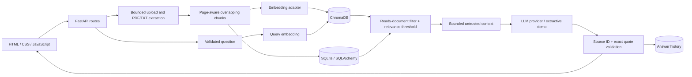

# AI Document Assistant (RAG)

A local document workspace for asking questions about PDF and TXT files, inspecting the supporting passages, and keeping a searchable document library with saved question history. Built as an AI/backend engineering portfolio project, with explicit failure handling and a working offline demo.



## What it does

- Upload UTF-8 TXT and text-based PDF documents; retain document names, upload timestamps, chunk IDs, and PDF page numbers.
- Split text at paragraph/sentence/word boundaries, with overlap and page isolation.
- Store document/chunk metadata in SQLite and embeddings in persistent ChromaDB.
- Retrieve passages from all ready documents or one explicitly selected document.
- Generate answers through an OpenAI-compatible API in full mode, with validated source IDs and exact supporting quotes.
- Abstain when retrieval has no qualifying evidence or generated citations fail validation.
- Inspect citations, revisit paginated history, clear history, and delete documents with their vectors and associated cited answers.
- Run without an API key, paid calls, or model downloads in the default **extractive demo**.

The demo genuinely indexes and retrieves files. Its deterministic hashing embeddings are a **lexical baseline**, and its responses are verbatim excerpts—not semantic AI or generated answers. Full mode uses Sentence Transformers and a configured LLM provider. The interface labels every response accordingly.

## Architecture



| Layer | Technology |
| --- | --- |
| API | Python 3.11+, FastAPI, Pydantic settings and schemas |
| Relational storage | SQLAlchemy 2, SQLite with foreign keys and WAL |
| Retrieval | ChromaDB cosine search; explicit caller-provided embeddings |
| Semantic embeddings | Sentence Transformers, `all-MiniLM-L6-v2` by default |
| Answer generation | HTTPX, OpenAI-compatible `/chat/completions` with JSON output |
| Extraction | pypdf, isolated PDF parser process; UTF-8 TXT decoder |
| Frontend | Responsive, same-origin HTML/CSS/JavaScript; no frontend build needed |
| Quality/deployment | Pytest, Ruff, GitHub Actions, Docker Compose |

See [architecture and implementation decisions](docs/architecture.md) for service boundaries, consistency, and scope.

```text
app/
  api/                 REST routes, schemas, request limits, browser guards
  services/            Parsing, chunking, embeddings, vectors, LLM, workflows
  static/              Interface and synthetic demonstration documents
  config.py            Environment configuration
  database.py          SQLite engine and sessions
  models.py            Document, chunk, metadata, and history models
  main.py              App factory and lifecycle
examples/              Predefined demo acceptance cases
scripts/               Optional real-model integration check
tests/                Offline unit, API, and storage integration tests
```

## Quick start: offline demo

Python 3.12 is recommended and was used for local verification. Python 3.11+ is declared supported; CI is configured for 3.11, 3.12, and 3.13. Dependency installation requires internet access. Running the default demo afterward does not.

From the repository root:

```bash
python3.12 -m venv .venv
source .venv/bin/activate
python -m pip install -e '.[dev]'
cp .env.example .env
uvicorn app.main:create_app --factory --host 127.0.0.1 --port 8011 --workers 1 --no-access-log
```

On Windows, activate with `.venv\Scripts\Activate.ps1` in PowerShell. Use `py -3.12` in place of `python3.12` to create the environment.

Open [the application](http://127.0.0.1:8011) and click **Try sample documents**. Try:

- “How many days of annual leave do employees receive?” → excerpt containing **28 days**.
- “What is the annual learning budget?” → excerpt containing **EUR 1,200**.
- “When does the Aurora pilot start?” → excerpt containing **2 November 2026**.
- “What is the quantum reactor temperature?” → insufficient information, no citations.

All supplied names, organizations, policies, and project details are synthetic. Expected results are in [examples/test-cases.json](examples/test-cases.json) and are exercised by Pytest.

Port 8011 avoids a port-8000 collision in the development workspace. Any free local port can be used. Run **one worker** against each data directory: SQLite and Chroma writes are coordinated by an in-process lock, not a distributed transaction or lock.

## Full semantic RAG

Install the optional model dependencies:

```bash
source .venv/bin/activate
python -m pip install -e '.[ai,dev]'
```

Set these values in your local `.env`:

```dotenv
APP_MODE=llm
EMBEDDING_BACKEND=sentence-transformers
EMBEDDING_MODEL=sentence-transformers/all-MiniLM-L6-v2
DATA_DIR=./data/semantic
LLM_BASE_URL=https://api.openai.com/v1
LLM_MODEL=your-provider-model-id
LLM_API_KEY=your-key-here
```

Restart the server using the quick-start command and re-upload your documents. A new data directory is required when changing embedding identity or chunking settings. The application rejects configuration mismatches rather than mixing incompatible vectors.

The first semantic startup downloads the public embedding model; later starts use the model cache. Optional `EMBEDDING_REVISION` pins a Hugging Face revision. Model code is loaded with `trust_remote_code=False`. Model weights are not bundled in the repository or Docker image.

The provider must support the chat-completions endpoint, `response_format: {"type":"json_object"}`, `temperature`, and `max_tokens`. Compatibility is intentionally explicit; unsupported endpoints return a structured error. There is no silent switch to demo mode. Use a model ID actually available from your provider.

For a locally hosted compatible LLM, use a loopback URL such as `http://127.0.0.1:1234/v1` and its served model ID. A key is optional for loopback providers; remote endpoints require HTTPS and a key. Container loopback points to the container itself, not the host.

To use semantic retrieval without a paid generator, keep `APP_MODE=demo` and set `EMBEDDING_BACKEND=sentence-transformers`. Answers remain explicitly extractive.

**Data flow:** full mode sends the question and retrieved excerpts to your configured provider. Demo mode sends neither to an LLM. The optional embedding model runs locally after download. Original uploaded files are not retained; extracted text, embeddings, and history are persisted in `DATA_DIR`.

## Configuration

Copy [.env.example](.env.example); never commit `.env` or real documents. Environment variables take precedence over the dotenv file.

| Variable | Default | Purpose |
| --- | --- | --- |
| `APP_MODE` | `demo` | `demo` excerpts or `llm` generation |
| `EMBEDDING_BACKEND` | `hashing` | Offline lexical baseline or `sentence-transformers` |
| `EMBEDDING_MODEL` | `sentence-transformers/all-MiniLM-L6-v2` | Semantic embedding model |
| `EMBEDDING_REVISION` | empty | Optional immutable model revision |
| `DATA_DIR` | `./data` | SQLite and persistent Chroma directory |
| `LLM_BASE_URL` | `https://api.openai.com/v1` | Server-configured provider base URL |
| `LLM_MODEL` | `gpt-4o-mini` | Provider model ID; change to an available model |
| `LLM_API_KEY` | empty | Server-side secret; never returned to the browser |
| `LLM_TIMEOUT_SECONDS` | `45` | HTTP I/O inactivity timeout; connect timeout is 10 seconds |
| `MAX_UPLOAD_MB` | `10` | Raw file size cap, enforced before parsing |
| `MAX_PDF_PAGES` | `200` | PDF page cap |
| `PARSING_TIMEOUT_SECONDS` | `30` | PDF parser wall-clock deadline |
| `MAX_EXTRACTED_CHARS` | `500000` | Extracted text limit |
| `MAX_CHUNKS` | `2000` | Maximum chunks per document |
| `CHUNK_SIZE` / `CHUNK_OVERLAP` | `700` / `120` | Characters; overlap must be less than half the size |
| `RETRIEVAL_TOP_K` | `5` | Maximum retrieved passages |
| `MIN_SIMILARITY` | `0.2` | Minimum cosine similarity; tune on your evaluation data |
| `MAX_CONTEXT_CHARS` | `6000` | Maximum excerpt text sent to the generator |
| `LOG_LEVEL` | `INFO` | Application logging level |

Similarity scores are retrieval scores, **not probabilities or answer confidence**. Character-based chunking is intentionally simple; larger chunks can exceed an embedding model's token limit and be truncated by that model.

[constraints.txt](constraints.txt) records the installed dependency versions from the Python 3.12/macOS verification environment, including optional AI and development packages. To reproduce those versions on a compatible interpreter, add `-c constraints.txt` to the install command. It is a version snapshot, not a cross-platform, hash-verified lockfile; unlisted platform dependencies can still vary.

## API

Interactive [Swagger docs](http://127.0.0.1:8011/docs), [ReDoc](http://127.0.0.1:8011/redoc), and [OpenAPI JSON](http://127.0.0.1:8011/openapi.json) are available locally. The developer documentation UI uses CDN assets; the application interface itself has no CDN dependency.

| Method | Endpoint | Behavior |
| --- | --- | --- |
| `GET` | `/api/health` | Startup status, mode, embedding backend, upload limit |
| `POST` | `/api/documents?filename=handbook.txt` | Raw binary upload; returns indexed document (`201`) |
| `GET` | `/api/documents` | Documents, status, chunk count, extraction warnings |
| `DELETE` | `/api/documents/{uuid}` | Delete vectors, chunks, document, and cited history (`204`) |
| `POST` | `/api/questions` | Question plus optional document UUIDs; answer and citations |
| `GET` | `/api/history?limit=25&offset=0` | Newest-first history; `limit` 1–100 |
| `DELETE` | `/api/history` | Clear saved questions and answers (`204`) |

Uploads use **raw bytes**, not multipart. Accepted content types: `application/octet-stream`, `application/pdf`, `text/plain`. Filename extension, PDF signature, text encoding, and parser validity are checked; the supplied MIME type is not trusted as proof of file type. Filenames are display metadata only, never filesystem paths.

```bash
curl -X POST 'http://127.0.0.1:8011/api/documents?filename=atlas-handbook.txt' \
  -H 'Content-Type: application/octet-stream' \
  --data-binary @app/static/examples/atlas-handbook.txt

curl -X POST http://127.0.0.1:8011/api/questions \
  -H 'Content-Type: application/json' \
  -d '{"question":"How many days of annual leave do employees receive?"}'

curl 'http://127.0.0.1:8011/api/history?limit=25&offset=0'
```

To scope retrieval, include `"document_ids":["<UUID returned by upload>"]`. Omitting it searches all ready documents; an empty array is rejected. Questions are limited to 2,000 characters and are independent turns; earlier chat is displayed but is not sent as conversational context.

Responses include `mode`, `insufficient_context`, and citations with `source_id`, `document_id`, `document_name`, `chunk_id`, `page`, `quote`, `similarity`, and `uploaded_at`. TXT page numbers are `null`.

Application errors have this shape:

```json
{"error":{"code":"no_text","message":"No text could be extracted. Image-only PDFs need OCR before upload."}}
```

Common statuses: `413` size/text/page/chunk limits, `415` unsupported type, `422` invalid input/document, `404` unknown/unavailable documents, `409` documents changed during generation, `502` provider errors, `503` indexing/retrieval/provider availability, `504` provider timeout. Provider error bodies and credentials are not echoed to the client. Host validation and transport-level errors may be produced before application handlers.

## Reliability and security decisions

- **Citation provenance:** the provider returns source IDs and exact quotes. The server obtains filenames/pages from retrieved metadata and rejects unknown IDs, fabricated quotes, malformed evidence, or unsupported answers without citations. This does not prove every generated claim follows logically from the quotes. Check sources.
- **Untrusted documents:** document text is JSON-encoded in user context, with an explicit system instruction to ignore embedded commands. The LLM has no tools or access to keys. This reduces risk; prompt injection is not a solved problem.
- **Cross-store consistency:** SQLite is authoritative. Only `ready` documents are queried. Incomplete indexing remains visible as `failed`; deletion marks `deleting` before vector removal. Failed cleanup is retried on startup, and failed deletion can be retried through the API. No atomic transaction across SQLite and Chroma is claimed.
- **Concurrent deletion:** an answer is rejected if one of its source documents was deleted during generation. Successful document deletion also removes saved answers citing that document.
- **File safety:** bounded raw-body streaming, sanitized display names, UTF-8/control-character checks, PDF signature/encryption checks, no retained originals, parser subprocess deadline. Image-only PDFs receive a useful error; mixed PDFs report skipped pages.
- **Browser safety:** same-origin writes, loopback host allowlist, no CORS opt-in, plain-text DOM rendering, CSP, no framing, no content sniffing, and no-store response headers. API documentation is exempt from the application CSP to support its external UI assets.
- **Local privacy:** application logs record IDs and error classes, not document text, questions, keys, or raw provider errors. Recommended startup disables HTTP access logs to avoid logging filenames in upload URLs. Data directories and secrets are ignored by Git. SQLite/Chroma deletion is logical deletion, not forensic secure erasure; backups and database free pages may retain data.

This is a **local, single-user MVP**. It has no authentication, authorization, tenant isolation, or rate limiting. Keep it bound to loopback. Parser subprocesses have deadlines and content limits, but no OS-level memory sandbox; do not expose uploads to untrusted public traffic.

## Tests and verification

```bash
source .venv/bin/activate
pytest --cov=app --cov-report=term-missing
ruff check app tests scripts
ruff format --check app tests scripts
```

The test suite requires no API key, internet, paid requests, or downloaded model. It uses temporary SQLite/Chroma directories and HTTPX mock transports. It covers parsing, PDF pages, chunk overlap/coverage, retrieval scoping, the predefined demo cases, API validation, upload caps, history, restart persistence, failed indexing/deletion recovery, citation correctness, provider errors/timeouts, and deletion during generation.

To exercise the real Sentence Transformers adapter with Chroma (initial download required):

```bash
python -m pip install -e '.[ai]'
HF_HOME=./data/model-cache python scripts/check_semantic.py
```

After the model is cached, add `HF_HUB_OFFLINE=1` for an offline rerun. The script verifies normalized 384-dimensional embeddings, paraphrase ranking, Chroma retrieval, and vector deletion. It never calls an LLM.

See [verification notes](docs/verification.md) for executed checks and explicit untested areas. GitHub Actions is configured; a successful remote CI run is not implied by local test results.

## Docker

```bash
cp .env.example .env
# Default offline demo, exposed only on host loopback port 8000:
docker compose up --build
```

Open [localhost:8000](http://127.0.0.1:8000). If occupied, change the host side of the Compose port mapping to `127.0.0.1:8011:8000`.

For semantic mode, configure `.env` as described above and build with `INSTALL_AI=true docker compose up --build`. Start with a new named volume when changing embedding configuration. Compose sets `DATA_DIR=/app/data` and preserves that directory in the `assistant-data` volume. The image runs as a non-root user with one worker. Deleting the volume deletes the persisted workspace; ordinary `docker compose down` retains it. Docker execution was not verified in this environment because Docker is not installed.

## Screenshots

The screenshots were captured from the working local application using only the supplied synthetic files.

- [Document workspace](docs/screenshots/workspace.png)
- [Answer with expanded source citation](docs/screenshots/citations.png)
- [Mobile layout](docs/screenshots/mobile.png)

## Phase 2

1. Authentication, tenant-scoped storage, quotas, rate limiting, and deployment hardening.
2. Background ingestion jobs, progress events, stronger parser resource isolation, and OCR.
3. Token-aware chunking, hybrid retrieval, reranking, and a reviewed grounding/abstention evaluation set.
4. Database migrations, cross-process coordination, reconciliation tooling, and explicit reindexing workflows.
5. Streaming answers, conversation-aware retrieval, richer PDF previews, and browser automation in CI.
6. Dependency locking with hashes, container scanning, backups, and document retention controls.

## References and license

Implementation references: [Chroma Python API](https://docs.trychroma.com/reference/python) and [Sentence Transformers model API](https://www.sbert.net/docs/package_reference/sentence_transformer/model.html). See [LICENSE](LICENSE) for the existing MIT license.
